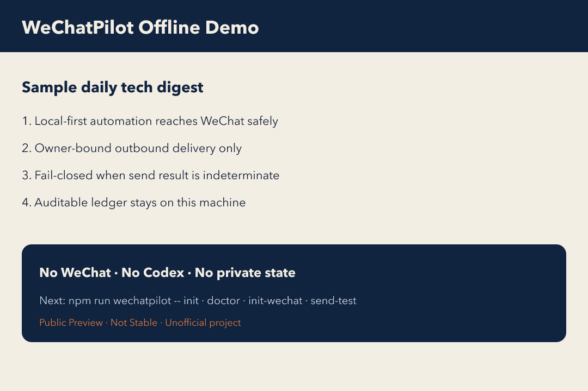

# WeChatPilot

[简体中文](README.md) | [English](README.en.md)

**让本地 AI 自动化安全地抵达微信，而不是让微信反向控制电脑。**

> Local-first, outbound-only, auditable AI automation for WeChat.



当前版本：**Public Preview `v0.1.0-beta.1`**。这不是 Stable，也不是 Production Ready。七日稳定性复盘（Issue #4）完成前，不得宣称链路已经稳定。

✅ 本地优先  
✅ 仅向扫码绑定的本人微信单向发送  
✅ 不开放远程命令、Shell 或 Codex 远程控制  
✅ 发送结果可审计；无法确认时拒绝自动重放  

> WeChatPilot 与微信、腾讯不存在隶属、授权或背书关系。请勿把本项目理解为官方产品。

## 5 分钟快速开始

要求：macOS、Node.js 22、已登录且可从 `PATH` 找到的官方 Codex CLI。

```sh
npm ci
npm run build
npm run wechatpilot -- demo
```

`demo` 完全离线：不访问微信、不调用 Codex、不读取私人 `.state` 凭据。它使用固定 Fixture，在本地生成示例日报文本和预览图，方便你先看最终效果。

完整安装：

```sh
npm run wechatpilot -- init
npm run wechatpilot -- doctor
./scripts/init-wechat.sh
npm run send:test
```

统一命令：

```sh
npm run wechatpilot -- init
npm run wechatpilot -- doctor
npm run wechatpilot -- doctor --repair
npm run wechatpilot -- demo
npm run wechatpilot -- config validate
npm run wechatpilot -- run daily-tech-digest --dry-run
npm run wechatpilot -- schedule install --hour 8 --minute 0
npm run wechatpilot -- schedule status
npm run wechatpilot -- schedule remove
```

`schedule install` 在安装时探测 Node/Codex，生成当前用户专属 plist。v0.1 固定使用简体中文、`Asia/Shanghai`、每日 08:00 与固定栏目配额；LaunchAgent 日历触发使用机器系统时区，因此运行机器也必须设为 `Asia/Shanghai`。`doctor` 默认输出人类可读结果（`--json` 保留机器格式），且默认只读；只有显式 `--repair` 才会删除已确认进程死亡、inode 未变化且未被 `sending/indeterminate` ledger 阻止的陈旧锁。

## 它解决什么问题

很多“微信 Bot”会把聊天入口变成电脑控制面。WeChatPilot 反过来：

1. 本机任务先跑完。
2. 结果经排序、生成、链接校验和 ledger。
3. 只向扫码绑定的本人微信单向投递。
4. 微信不能启动任务、不能选择收件人、不能执行 Shell。

当前唯一内置工作流：**每日科技情报**。

## 安全边界

| 能力 | 普通远程控制 Bot | WeChatPilot |
| --- | ---: | ---: |
| 微信触发电脑命令 | 可能支持 | 明确禁止 |
| 任意收件人 | 可能支持 | 仅绑定本人 |
| 不确定发送自动重试 | 可能重复发送 | 默认停止 |
| 凭据本地保存 | 不一定 | 是 |
| 运行与投递 Ledger | 不一定 | 是 |

更多细节：

- 配置模型：`UserConfig` / `SecurityProfile` / `ResolvedRuntime`
- 微信 transport 与供应链：`src/transport/wechat-transport.ts`、`docs/security/runtime-closure.md`、`security/openvex.json`
- 隐私与数据流：`PRIVACY.md`、`DATA_FLOW.md`
- 威胁模型：`THREAT_MODEL.md`

## 配置模型

- `UserConfig`：`config/sources.yaml`、`ranking.yaml`、`digest.yaml` 与 observer 的来源和通知策略；v0.1 的时区、语言、配额、栏目和篇幅为固定契约。
- `SecurityProfile`：代码中固定的 Codex 只读参数、禁用工具、stdin-only、输出上限、本人收件人约束和禁止参数。
- `ResolvedRuntime`：`wechatpilot init` 探测的 Node/Codex 绝对路径、版本与能力，写入私有 `.state/runtime.json`，不进入版本控制。

用户配置可修改，但不能覆盖安全参数。Codex 子进程保持 ephemeral、read-only、approval never，只通过 stdin 接收候选数据；Apps、插件、hooks、shell、浏览器、computer-use、多代理和额外目录均被禁用。

## 微信 transport 与供应链

项目不再携带 `cli-in-wechat` submodule，也不安装其 `undici` 或开发依赖。最小 transport 位于 `src/transport/wechat-transport.ts`，只实现扫码登录、重试请求和主动发送所需能力。CI 会执行生产依赖审计，并禁止重新引入上游主入口、Router、适配器注册表、代理初始化器、`ProxyAgent` 或 `undici`。

## 正确性与网络安全

- 微信 `message_id` 使用 lossless JSON 解析并在内部、状态文件和去重集合中统一为规范十进制字符串；旧的安全整数状态会自动迁移。
- 来源链接每一跳只解析一次，验证全部地址均为公网后，把本次已验证地址钉入实际 TCP/TLS 连接；Host 与 TLS SNI 保持原域名，重定向后重新解析和验证。
- scheduled、日报投递和 observer 锁都记录 PID、nonce、createdAt，并在恢复与释放时核验文件身份。日报锁恢复还受 delivery ledger 约束，无法确认的发送绝不自动重放。

## 隐私与数据流

“本地优先”指调度、凭据、ledger、锁和审计在本地，不代表模型推理完全离线。候选标题、摘要和公开 URL 会进入 Codex 子进程；微信 Token、context token 和用户 ID 不会进入模型。

## 目录布局

- `appRoot`：程序代码与内置资源
- `workspaceRoot`：用户配置、输出、历史、日志
- `stateRoot`：凭据、ledger、锁、outbox

兼容默认仍落在项目目录；可通过 profile root / 环境变量拆分。详见 [ARCHITECTURE.md](ARCHITECTURE.md)。

## 已知限制

- 仅支持 macOS。
- 需要 Node.js 22 与已登录 Codex CLI。
- v0.1 固定简体中文与 `Asia/Shanghai`。
- 仅向扫码绑定的本人微信单向投递。
- 不提供入站命令、远程 Shell 或 Codex 远程控制。
- 当前只有“每日科技情报”一个内置工作流。
- Public Preview，不是 Stable。

## 稳定性门禁

平台抽象 Issue #1 明确依赖七天稳定性复盘 Issue #4。复盘只允许输出脱敏计数和耗时分布，不包含正文、路径、身份或凭据。未收集满七个自然日时，项目不得宣称链路“已经稳定”，也不得开始通用平台抽象。

## 常用命令

```sh
npm test
npm run typecheck
npm run build
npm run audit:runtime
npm run check:transport-boundary
npm run wechatpilot -- demo
./scripts/generate-digest.sh --dry-run
./scripts/send-test.sh
./scripts/send-digest.sh --date YYYY-MM-DD
```

日志会递归脱敏。请勿在公开 Issue 提交 Token、Cookie、微信用户 ID、context token、二维码、私有正文、日志或本机路径。漏洞请使用 GitHub 私密安全报告。

WeChatPilot 自有代码采用 MIT License；第三方依赖见 `THIRD_PARTY_NOTICES.md` 与 `package-lock.json`。

贡献指南见 [CONTRIBUTING.md](CONTRIBUTING.md)。英文说明见 [README.en.md](README.en.md)。
